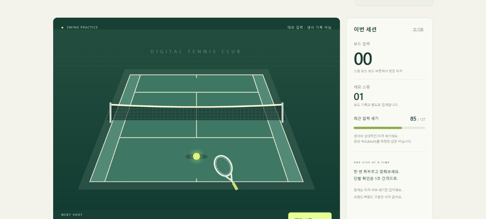
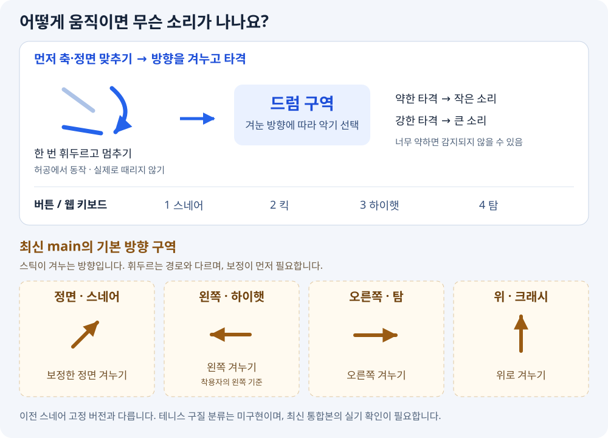

# Digital Tennis / Air Band — 센서 입력 프로토타입

## 이번 PR의 구현 범위

이번 단계의 완료 기준은 **센서 타격·세기를 BLE로 전달하고, 웹 코트에서 입력을 시각화하는 것**입니다.
테니스 경기 전체나 포핸드/백핸드 자동 분류까지 구현한 상태는 아닙니다.

- 구현: LSM6 초기화 검증, 타격 감지·세기, BLE 연결, 150ms 중복 억제 설정,
  테니스 코트 그림과 공 반응, 보드/데모 입력 별도 집계, 세기 표시·기록·초기화.
- 기존 드럼 진단: `index.html`. 센서 타격은 스네어 고정이고 버튼 1~4는 드럼별 입력입니다.
- 테니스 화면: 개발 서버에서 **`/tennis.html`**. 기존 화면의 `테니스 코트` 링크로도 이동합니다.
  `데모 스윙` 또는 페이지에서 Space로 보드 없이 확인할 수 있습니다.
  BLE를 연결하면 같은 8바이트 타격 패킷으로 공이 반응합니다. 테니스 화면에는 드럼 소리를 재생하지 않습니다.
- 테니스 화면의 공 경로는 연출입니다. 실제 구속·착지 위치·득점·포핸드/백핸드는 판단하지 않습니다.
  보드 버튼과 센서 타격은 패킷으로 구분할 수 없어 모두 `보드 입력`으로 집계합니다.
- 실기 확인 필요: 150ms 수정본의 단발·연타와 새 테니스 화면에서의 실제 BLE 입력.
  기존 펌웨어의 센서→BLE→드럼 소리는 다른 PC의 결과 화면에서 성공이 보고됐습니다.

기존 Windows PC에서 코드·Git·PR을 관리하고, 다른 PC에서는 전달받은 버전의 업로드·실기 테스트를 합니다.
이 브랜치의 화면을 보려면 해당 소스로 실행/빌드해야 합니다. 기존 공개 사이트에 자동 배포되는 것은 아닙니다.



### 기존 한 손 드럼 진단

스틱(센서)을 휘두르면 브라우저에서 드럼 소리가 나는 데모입니다.
IMU가 없어도 **보드 버튼 1~4로 드럼 4개(스네어/킥/하이햇/탐)** 를 칠 수 있습니다 (아래 "버튼 드럼 모드").

## 어떻게 움직이면 무슨 소리가 나나요?

**현재 센서는 타격 여부와 세기를 감지하며, 드럼 종류는 스네어로 고정입니다.**
아래쪽·옆쪽 등 움직이는 방향을 바꿔도 다른 드럼으로 전환되지 않습니다.
동작별로 다른 드럼을 연주하려면 별도의 동작 구분 기능을 추가해야 합니다.



### 지금 해볼 수 있는 동작

1. 센서를 손이나 스틱에 흔들리지 않게 고정하고, USB 케이블이 당겨지지 않게 둡니다.
2. 웹에서 `센서 연결`로 `AirBand-R`에 연결합니다.
3. 허공에서 가볍게 **한 번 휘두른 뒤 멈춥니다**. 예를 들어 스틱을 아래로 내리며 멈추는 동작입니다.
   책상이나 보드를 실제로 때릴 필요는 없습니다. 타격 기준을 넘으면 스네어가 납니다.
4. 같은 동작을 약하게/강하게 해보면 타격 세기(`velocity`)와 음량이 달라집니다.
   너무 약한 움직임은 타격으로 잡히지 않을 수 있습니다.
5. 단발 확인은 1초 이상 쉬며 반복합니다. 현재 150ms 미만 간격의 후속 피크는 무시하므로
   매우 빠른 연타는 일부 빠질 수 있습니다. 수정본의 단발 중복 억제 효과는 실기 확인이 남아 있습니다.

다른 소리를 바로 확인하려면 **보드 버튼 1=스네어, 2=킥, 3=하이햇, 4=탐**을 누르세요.
웹 키보드 `1`~`4`와 화면 패드도 같은 소리를 냅니다.
이 버튼들은 누르는 즉시 해당 소리를 내는 기능이며, 이후 센서 흔들기의 악기를 선택하는 기능은 아닙니다.

### 다음 단계의 동작 후보 — 아직 구현되지 않음

아래는 동작을 설명하고 데이터를 모으기 위한 **초안**입니다. 현재 펌웨어에 적용된 조작법이나
확정된 인식 성능이 아닙니다. 방향은 착용자 몸 기준이며, 센서 장착 방향을 일정하게 해야 합니다.

- **스네어 후보:** 손을 아래로 내리며 멈추기.
- **킥 후보:** 손을 몸 앞쪽으로 짧게 내밀며 멈추기. 한 손 센서용 대체 동작이며 발 동작을 감지하는 것이 아닙니다.
- **하이햇 후보:** 손을 오른쪽으로 짧게 쓸며 멈추기.
- **탐 후보:** 손을 오른쪽 아래 대각선으로 내리며 멈추기.

특히 아래쪽과 대각선 동작은 혼동될 수 있습니다. 각 동작과 정지·걷기·손 되돌리기의
센서 기록을 모아 구별 가능한지 먼저 확인하고, 잘 안 나뉘면 동작 자체를 바꿔야 합니다.
IMU 값만으로 손이 공간의 어느 드럼 위치에 있는지 바로 알 수 있는 것은 아닙니다.

구현 위치는 펌웨어의 `classifyHit()`입니다. 현재 이 함수는 항상 `0`(스네어)을 반환합니다.
지금 읽는 데이터는 가속도 3축이며, 자이로 데이터는 아직 읽지 않습니다.
기존 최근 0.2초 가속도 버퍼를 바탕으로 규칙이나 학습 모델을 붙일 수 있지만,
필요한 기록 길이와 자이로 사용 여부는 실제 동작 데이터를 보고 결정해야 합니다.
코드·Git 작업은 기존 Windows PC에서, 업로드·실기 테스트는 다른 PC에서 진행합니다.

```
[NU40 DK + 6축 IMU] --BLE(NUS)--> [브라우저 웹앱: Web Bluetooth → Web Audio → Canvas]
```

```
air-band/
├ firmware/air_band_right/air_band_right.ino   누코드 펌웨어
├ web/                                         웹앱 (TypeScript + Vite, 프레임워크 없음)
├ docs/blog-air-band-poc.md                    블로그 글 (스크린샷: docs/images/)
├ docs/slides.html                             발표 자료 (reveal.js, 브라우저로 열기)
└ README.md
```

---

## 1. 배선 (IMU ↔ NU40 DK)

### 누코드 LSM6DS3TR 계열로 빠르게 확인하기

1. 전원을 끈 상태에서 모듈의 전원/GND/SDA/SCL을 아래 배선에 맞게 연결합니다.
   NU-IMU 커넥터를 사용하는 경우 모듈과 보드의 핀 표기를 확인하세요.
2. 이 프로젝트에서 관측한 NU40 DK의 기존 장치가 `0x6A`를 사용하므로,
   센서는 가능하면 SA0 설정을 통해 `0x6B`로 사용합니다. 모듈의 주소 변경 방법은
   실제 기판 표기/설명서를 확인하고, 임의로 패드를 연결하지 마세요.
3. 펌웨어 업로드 후 시리얼 모니터를 **115200 baud**로 엽니다.
   `LSM6 WHO_AM_I=0x69`(LSM6DS3) 또는 `0x6A`(LSM6DS3TR-C/LSM6DSL),
   `accel=416Hz range=16g BDU=on` 및 감지된 버스 주소를 확인합니다.
   **WHO_AM_I 값과 I2C 버스 주소는 서로 다른 값입니다.**
4. `DEBUG_IMU=1`이면 1초마다 `ax/ay/az`가 표시됩니다. 정지 시 세 축의
   합성 크기가 약 1g이고, 움직이면 값이 변해야 합니다. 읽기 실패가 계속되거나
   `없음`이면 전원을 끄고 배선을 확인한 후 보드를 다시 시작하세요.
5. 웹앱에서 `센서 연결`로 `AirBand-R`에 연결한 뒤 센서를 휘둘러 멈춥니다.
   `HIT ...` 로그, 웹의 타격 표시, 스네어 소리가 함께 발생하는지 확인합니다.
   약하게/세게 휘두를 때 `vel`이 달라지는지도 확인합니다.

이번 한 손 드럼은 **가속도 3축으로 타격을 감지**합니다. 자이로 기반 방향 판별이나
여러 드럼의 동작 분류는 포함하지 않습니다. 기본값은 `DEBUG_IMU=0`이며,
센서 값을 진단할 때만 1로 바꿉니다. `DEBUG_RAW=1`일 때는 확인 로그가 자동으로 꺼집니다.

레지스터 설정 근거: [ST LSM6DS3TR-C 데이터시트](https://www.st.com/resource/en/datasheet/lsm6ds3tr-c.pdf).
실제 보드·센서에서의 배선, 타격 민감도, 소리 출력은 아래 절차로 검증해야 합니다.

| IMU 핀 | NU40 DK | 비고 |
|---|---|---|
| VCC / VIN | 3V3 | IMU 모듈이 3.3V를 지원하는지 확인 (5V 전용 모듈 금지) |
| GND | GND | |
| SDA | **P0.26** | BSP 기본 `PIN_WIRE_SDA` |
| SCL | **P0.27** | BSP 기본 `PIN_WIRE_SCL` |
| AD0 / SA0 | 아래 "I2C 주소" 참고 | |
| INT | (미사용) | 1단계는 폴링 방식 |

- P0.26 / P0.27은 누코드 BSP의 `variants/nu40dk_nrf52840/variant.h`에 정의된 기본 I2C 핀입니다.
  **TODO: 확인 필요 — 보드 헤더에서 P0.26, P0.27이 실제로 어느 핀인지는 NU40 DK 핀맵/실크로 확인하세요.**
- 다른 핀에 연결했다면 `air_band_right.ino` 상단의 `PIN_IMU_SDA`, `PIN_IMU_SCL` 두 값만 바꾸면 됩니다.
  이 BSP는 **아두이노 핀 번호 = nRF GPIO 번호**입니다 (P0.xx → `xx`, P1.xx → `32 + xx`).
- 대부분의 IMU 브레이크아웃 모듈에는 풀업 저항이 달려 있습니다. 칩만 쓰는 경우 SDA/SCL에 4.7kΩ 풀업을 3V3에 달아 주세요.

### I2C 주소 주의 — 0x6A는 이미 사용 중

IMU를 연결하지 않은 상태에서 이 보드의 I2C 버스를 스캔하면 **0x6A에 IMU가 아닌 장치가 하나 있습니다**
(레지스터가 0x00~0x0C 13개뿐이고, 가속도 레지스터가 없습니다. 보드에 실장된 전원/충전 IC로 보이지만 확인이 필요합니다).
그래서 IMU는 0x6A와 **겹치지 않는 주소**로 설정해야 합니다.

| IMU 계열 | 권장 주소 | 설정 |
|---|---|---|
| MPU-6050 / MPU-6500 | 0x68 | AD0 → GND |
| LSM6DS3 / LSM6DSL / LSM6DSO | **0x6B** | SA0 → 3V3 (**0x6A는 쓰지 말 것**) |

### 지원 IMU

펌웨어는 부팅 시 WHO_AM_I 레지스터를 읽어 아래 두 계열을 자동 감지합니다. 외부 라이브러리는 필요 없습니다.

- MPU-6050 / 6500 / 9250 계열 (0x68, 0x69)
- ST LSM6DS3 / LSM6DS3TR-C / LSM6DSL / LSM6DSO 계열 (0x6A, 0x6B)

다른 IMU(BMI160, ICM-42688 등)를 쓰려면 `imuBegin()`과 `imuReadAccel()`에 드라이버를 추가하면 됩니다.
두 함수가 IMU 모델별 코드를 두는 유일한 곳입니다. `imuReadAccel()`은 **g 단위**로 값을 돌려주면 되고, 나머지 코드는 고칠 필요가 없습니다.

감지에 실패하면 LED1이 빠르게 깜빡이고, 시리얼에 I2C 스캔 결과와 각 주소의 WHO_AM_I 값을 2초마다 출력합니다.

```
[I2C] scan: 0x68 0x6A
[IMU] 0x68 reg0x0F=.. reg0x75=68 reg0x00=..
```

### 버튼 드럼 모드 (IMU 없이)

부팅 시 IMU를 3번 찾아보고 없으면 **버튼 전용 모드**로 넘어가 BLE 광고를 시작합니다. IMU가 있어도 버튼은 항상 동작합니다.

| 보드 버튼 | 핀 | 드럼 (class) | 웹 키보드 |
|---|---|---|---|
| 1 | P0.11 | 스네어 (0) | `1` |
| 2 | P0.12 | 킥 (1) | `2` |
| 3 | P0.24 | 하이햇 (2) | `3` |
| 4 | P0.25 | 탐 (3) | `4` |

- 눌리는 순간에만 전송, 디바운스 25ms, 세기는 100 고정 (`BUTTON_VELOCITY`)
- 끄려면 `ENABLE_BUTTONS`를 0으로 (그러면 예전처럼 IMU를 찾을 때까지 기다림)
- 웹 화면의 패드 4개도 클릭/터치/키보드 `1`~`4`로 칠 수 있습니다 (보드 없이 시연용)

---

## 2. 아두이노 IDE 설정과 업로드

1. **파일 → 기본 설정 → 추가 보드 관리자 URL**에 아래 주소를 추가합니다 (이 PC에는 이미 추가되어 있습니다).
   ```
   https://raw.githubusercontent.com/Nucode01/Adafruit_nRF52_Arduino/refs/heads/master/package_nuduino_index.json
   ```
2. **보드 관리자**에서 `NUBoards nRF52 by NUCODE`를 설치합니다 (이 PC에는 1.0.2가 설치되어 있습니다).
3. **도구 → 보드 → NUBoards nRF52 → NU40DK nRF52840**를 선택합니다 (FQBN `nucode:nrf52:nu40dk`).
4. **도구 → 포트**에서 보드의 COM 포트를 선택합니다.
   - 앱 펌웨어가 돌 때와 부트로더 모드일 때 COM 번호가 다를 수 있습니다 (이 PC에서는 COM3/COM4). 업로드 도구가 자동으로 처리합니다.
5. `firmware/air_band_right/air_band_right.ino`를 열고 **업로드**합니다.
   Bluefruit, Wire 라이브러리는 BSP에 포함되어 있어 따로 설치할 게 없습니다.
6. **시리얼 모니터 115200 baud**를 엽니다. 정상이면 다음처럼 출력됩니다.
   ```
   === AirBand-R 1단계 데모 ===
   [I2C] scan: 0x68 0x6A
   [IMU] MPU-6050 계열 @ 0x68
   [BTN] 버튼 1~4 → 드럼 0~3 (스네어/킥/하이햇/탐)
   [BLE] 광고 시작: AirBand-R
   HIT t=12345 peak=5.21g vel=36 cls=0
   ```

명령줄로 하려면 (IDE에 들어 있는 arduino-cli 사용):

```powershell
$cli = "$env:LOCALAPPDATA\Programs\Arduino IDE\resources\app\lib\backend\resources\arduino-cli.exe"
& $cli compile --fqbn nucode:nrf52:nu40dk -u -p COM3 firmware\air_band_right
```

### 펌웨어 디버그 플래그

| 플래그 | 기본 | 설명 |
|---|---|---|
| `DEBUG_HITS` | 1 | 타격마다 `HIT t=.. peak=..g vel=.. cls=..`, 버튼마다 `BTN t=.. button=.. cls=..` 출력 |
| `DEBUG_IMU` | 0 | 1이면 1초마다 센서 가속도/읽기 상태 출력. 타격 로그는 별도 유지 |
| `DEBUG_RAW` | 0 | 1이면 100Hz로 `ax,ay,az`(g 단위) CSV만 출력. 다른 로그는 모두 꺼짐 (Edge Impulse 수집용) |

### LED

- LED1: 타격마다 30ms 켜짐. IMU를 못 찾으면 빠르게 깜빡임
- LED2: BLE 연결 상태 (Bluefruit 기본 동작)

---

## 3. 웹앱 실행

Node.js 18 이상이 필요합니다 (이 PC의 WSL에는 nvm으로 v24가 설치되어 있습니다).
WSL에서 `/mnt/c` 아래 프로젝트로 `npm install`이 `EPERM: chmod`로 실패하면 `/etc/wsl.conf`에 아래를 넣고 `wsl --shutdown` 후 다시 여세요.

```ini
[automount]
options = "metadata,uid=1000,gid=1000,umask=022"
```

```bash
cd air-band/web
npm install
npm run dev        # http://localhost:5173
```

1. PC의 **Chrome 또는 Edge**로 `http://localhost:5173`을 엽니다.
2. 드럼 패드(또는 키보드 `1`~`4`, 스페이스바 = 무작위 테스트 타격)로 먼저 소리와 이펙트를 확인합니다.
3. **센서 연결** → 목록에서 `AirBand-R` 선택 → 보드 버튼 누르기 / 휘두르기.

정적 빌드: `npm run build` → `web/dist/`를 아무 HTTPS 정적 호스팅(GitHub Pages, Netlify 등)에 올리면 됩니다.

### HTTPS / 브라우저 지원

- Web Bluetooth는 **HTTPS 또는 localhost에서만** 동작합니다. `http://192.168.x.x:5173` 같은 주소로는 연결 버튼이 비활성화됩니다.
- 지원: PC Chrome/Edge (Windows, macOS, Linux*), Android Chrome.
- 미지원: **iOS Safari/Chrome**, Firefox. 이 경우 화면 상단에 안내 메시지가 뜹니다. (iOS는 Bluefy 같은 Web Bluetooth 지원 앱 브라우저로 시도해 볼 수 있습니다.)
  \* Linux는 `chrome://flags/#enable-experimental-web-platform-features` 설정이 필요할 수 있습니다.

### 폰(Android)에서 테스트

- **방법 A (권장)**: USB 디버깅을 켜고 `adb reverse tcp:5173 tcp:5173` → 폰 Chrome에서 `http://localhost:5173`을 엽니다 (localhost라서 HTTPS가 필요 없습니다).
- **방법 B**: `npm run build` 결과를 HTTPS 호스팅에 올리고 접속합니다.

### 샘플 파일

`web/public/samples/{snare,kick,hihat,tom}.wav`가 있으면 그 파일을 쓰고, 없으면 해당 드럼 소리를 합성해서 씁니다. 화면 상단의 "소리" 항목에서 어느 쪽을 쓰는지 표시됩니다.
어느 쪽이든 앱 시작 시 한 번만 AudioBuffer로 준비하고, 타격 때는 재생만 합니다.

### 화면의 지연 표시

| 항목 | 의미 |
|---|---|
| 수신 → 재생 호출 | BLE notify를 받은 시각부터 `start()`를 부른 시각까지. 보통 1ms 미만이어야 합니다 |
| 오디오 출력 버퍼 | `AudioContext.baseLatency + outputLatency`. OS/오디오 장치에 따라 다릅니다 (블루투스 이어폰은 100ms 이상) |
| BLE 지터 | (수신 시각 − 보드 타임스탬프)가 세션 최솟값보다 얼마나 늦었는지. 크게 흔들리면 연결 간격이나 무선 환경 문제입니다 |

보드 시계와 브라우저 시계는 맞춰져 있지 않으므로, 센서→브라우저 절대 지연은 표시하지 않고 **지터(상대값)** 만 표시합니다.

---

## 4. 튜닝 가이드

모든 상수는 `air_band_right.ino` 상단 "타격 감지 / 세기 튜닝 상수"에 있습니다. 값은 **중력 1g가 포함된 3축 가속도 크기(g)** 입니다.

| 증상 | 조정 |
|---|---|
| 타격이 안 잡힘 / 약하게 치면 안 잡힘 | `HIT_THRESHOLD_G` ↓ (예: 2.5 → 2.0) |
| 걷거나 손만 움직여도 소리가 남 | `HIT_THRESHOLD_G` ↑ (예: 2.5 → 3.0~3.5) |
| 한 번 쳤는데 두 번 소리가 남 (스틱 반동) | `REFRACTORY_MS` ↑ (기본 150 → 200). 늦은 반동은 여전히 검출될 수 있음 |
| 빠른 연타 중 일부가 빠짐 | `REFRACTORY_MS` ↓ (예: 150 → 120). 단, 이중 타격과 균형 필요 |
| 세게 쳐도 소리가 작음 | `VEL_MAX_G` ↓ (예: 12 → 8) |
| 약하게 쳐도 소리가 큼 / 세기 차이가 없음 | `VEL_MAX_G` ↑, 또는 웹의 `velocityToGain()` 곡선 지수(1.6)를 ↑ |

튜닝 요령: `DEBUG_HITS=1` 상태에서 시리얼 모니터를 켜고, 약하게/세게/걷기/가만히 들기를 각각 해 보면서 `peak=` 값을 봅니다.
걷기에서 나오는 최대 peak보다 조금 높게 `HIT_THRESHOLD_G`를, 가장 세게 쳤을 때 peak 근처로 `VEL_MAX_G`를 잡으면 됩니다.

현재 불응기는 150ms입니다. 첫 타격을 150ms 늦추는 설정이 아니라, 인정된 타격의
피크 시각부터 150ms 미만에 발생한 다음 피크를 무시합니다. 무시한 피크가 불응기를
연장하지는 않습니다. 150ms 이상 간격의 피크는 기존 조건을 만족하면 통과합니다.
이 값은 다른 PC에서 보고된 단발 중복을 줄이기 위한 초기 조정이며, 수정본의 실기
검증은 아직 필요합니다. 단발 20회에서 동작당 HIT가 하나인지, 200ms 간격 연타가
빠지지 않는지 확인하고, 150ms 미만 연타가 걸러지는 것은 설정에 따른 동작입니다.
300ms 안의 HIT를 전부 중복으로 판단하지 말고 실제 동작과 로그를 비교하세요.

동작 원리:
- 샘플링은 `micros()` 경과시간 비교로 10ms(100Hz) 주기를 유지합니다.
- 직전 샘플이 **국소 최대값**(앞 샘플보다 크고 뒤 샘플보다 작지 않음)이고, 임계값 이상이며, 불응기가 지났을 때 타격으로 판정합니다. 피크 값을 정확히 쓰려고 한 샘플(10ms) 뒤에 판정합니다.
- 판정 결과는 FreeRTOS 큐에 대기 없이(`timeout 0`) 넣고, 별도 태스크가 BLE notify를 보냅니다.
  Bluefruit의 notify는 송신 버퍼가 가득 차면 최대 100ms까지 대기할 수 있어서, 샘플링 루프와 분리해 두었습니다.
- IMU 측정 범위는 ±16g입니다. 매우 세게 휘두르면 16g에서 잘릴 수 있습니다.

---

## 5. 2단계: TinyML 분류 붙이기

1. **데이터 수집**
   - `DEBUG_RAW`를 1로 바꾸고 업로드합니다. 시리얼로 `ax,ay,az`가 100Hz로 나옵니다.
   - 시리얼 모니터는 닫고 `npm install -g edge-impulse-cli` → `edge-impulse-data-forwarder`를 실행한 뒤, 프로젝트와 축 이름(`ax,ay,az`)을 지정합니다.
   - Edge Impulse Studio에서 클래스별(스네어, 하이햇, 심벌, 탐 …)로 동작을 녹화합니다. 각 샘플은 타격 한 번이 **0.2초 창**(20샘플) 안에 들어오도록 자릅니다. 펌웨어의 링버퍼 길이와 같아야 합니다.
2. **학습**
   - Impulse: 시계열 입력(창 200ms, 100Hz) → Spectral Analysis 또는 Raw Data → Classification.
   - 배포: **Arduino library**로 내보낸 뒤, 아두이노 IDE에서 **스케치 → 라이브러리 포함 → .ZIP 라이브러리 추가**.
3. **`classifyHit` 교체**
   - `classifyHit(const SampleBuffer& buf)` 안에서 `buf.at(0)` ~ `buf.at(buf.count - 1)`(오래된 순)을 `ax, ay, az` 순서로 펼쳐 Edge Impulse의 `run_classifier()` 입력으로 넣고, 가장 높은 확률의 클래스 번호를 반환합니다.
   - 추론 시간이 수 ms를 넘으면 샘플링이 밀리므로, 그 경우 추론을 별도 태스크로 옮기고 결과를 큐로 받도록 바꾸세요.
   - 웹의 `web/src/audio.ts`에 있는 `DRUM_CLASSES`에 클래스 번호 → 샘플 이름을 추가하고 `public/samples/`에 wav 파일을 넣습니다.

---

## BLE 스펙 요약

- Nordic UART Service: `6e400001-b5a3-f393-e0a9-e50e24dcca9e`
  - TX(notify, 보드→브라우저) `6e400003-…`, RX(write, 브라우저→보드) `6e400002-…` (RX는 현재 미사용)
- 광고 이름 `AirBand-R` (광고 패킷에 NUS UUID, 스캔 응답에 이름)
- 연결 간격 7.5~15ms 요청 (중앙 장치가 다른 값을 줄 수 있음)
- 타격 패킷 8바이트, little-endian

| 바이트 | 필드 | 값 |
|---|---|---|
| 0 | hand | 0 = 오른손 |
| 1 | mode | 0 = 드럼 |
| 2 | class | 0 스네어 · 1 킥 · 2 하이햇 · 3 탐 |
| 3 | velocity | 1~127 (타격이면 최소 1) |
| 4-7 | timestamp | 보드 `millis()` (uint32) |
